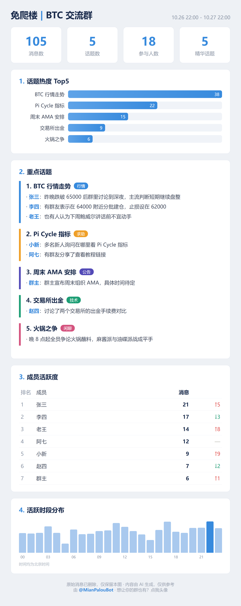

<div align="center">

# 免爬楼 · CatchUp

**Telegram 群聊日报机器人 —— 每天一张图，看完 24 小时精华**

把机器人拉进群，每天自动把过去 24 小时的群聊精炼成一张日报长图发回群里。
2000+ 未读，40 秒看完。

[示例日报](docs/demo.png) · [在线版机器人](https://t.me/qunribaobot) · [快速开始](#快速开始)



</div>

## 为什么做这个

- 加了几十个群，未读永远 9999+，爬楼爬到头秃
- 市面上的总结 bot 要么死了（数据库爆了）、要么收费贵、要么总结质量一言难尽
- 所以自己写了一个：**开源、自部署、看完即焚、宁缺毋滥**

## 功能

- **零配置**：拉进群即工作，不需要管理员权限，不发欢迎语不打扰
- **日报长图**：1080px 信息图——4 大数据 + 话题热度 Top5 + 分色话题块 + 成员活跃榜 + 时段分布
- **自动适配发送时间**：按群语言预估时区，每天当地时间 20:00（睡前黄金档）发送
- **多语言**：中文群出中文、英文群出英文，自动识别，无需设置
- **看完即焚**：日报发完立刻删除原始消息，数据库只留统计数字
- **宁缺毋滥**：消息太少或全是水聊就不发；LLM 挂了静默跳过，绝不报错刷存在感
- **防身规则**：只转述不站队、红线内容跳过、不照抄链接、不 @ 任何人

## 快速开始（在线版，0 部署）

1. 把 [@qunribaobot](https://t.me/qunribaobot) 拉进你的群
2. 完事。明天看日报。

## 快速开始（自部署）

```bash
git clone https://github.com/你的用户名/mianpalou-tg-digest.git
cd mianpalou-tg-digest
pip install -r requirements.txt
playwright install chromium

cp .env.example .env   # 填入 BOT_TOKEN 和 LLM API Key
python bot.py
```

你需要：
- 一个 Telegram Bot Token（找 [@BotFather](https://t.me/BotFather) 创建，**记得 /setprivacy → Disable**）
- 一个 LLM API Key（默认 DeepSeek，兼容 OpenAI 格式的都行，也支持 Gemini）

详见 [README 部署章节](#部署到-vps)。

## 工作原理

```
透明人进群收消息（SQLite 暂存）
  → 每天当地 20:00，把 24h 消息交给 LLM
  → LLM 按防身铁律输出结构化 JSON（只转述、不站队、红线跳过）
  → 填入 HTML 模板 → Chromium 截图成 1080px 长图
  → 发回群里 → 立刻删除全部原始消息
```

AI 只负责产内容，版面由模板锁死，样式永远统一。

## 部署到 VPS

任意 1核1G+ 的海外 VPS（Ubuntu 22.04/24.04），3 分钟：

```bash
apt install -y python3-venv python3-pip fonts-noto-cjk
git clone <仓库地址> /opt/mianpalou && cd /opt/mianpalou
python3 -m venv venv && ./venv/bin/pip install -r requirements.txt
./venv/bin/playwright install --with-deps chromium
```

systemd 服务示例见仓库内 `docs/mianpalou.service`。

## 设计取舍（README 之外的大实话）

- **消息在日报发出前必须暂存**，这是 Bot API 架构决定的。我们能做的是发完即删、库里只留统计数字——如果你连「暂存几小时」都不能接受，这个产品不适合你的群，也请尊重自己的判断
- **收不到入群前的历史消息**、**收不到其他 bot 的消息**，Telegram 官方限制，无解
- 不做已读回执、不做已删除消息的追踪，bot 是工具不是监控

## License

MIT —— 随便用，但请别拿去做监控工具。
